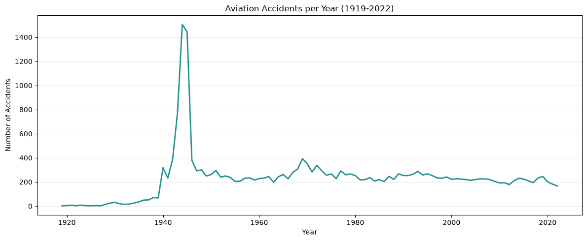
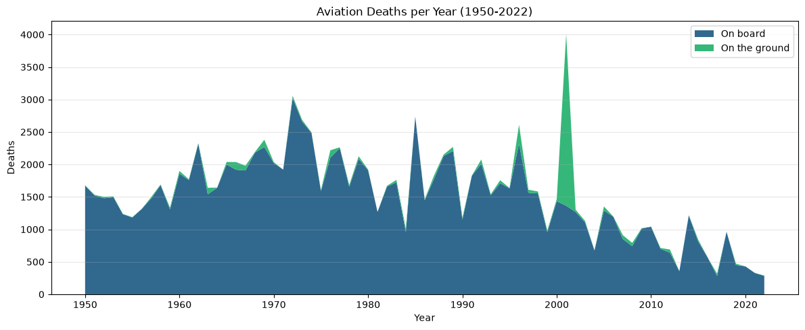
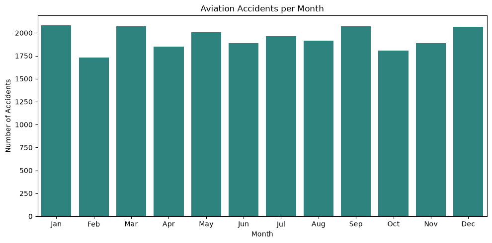
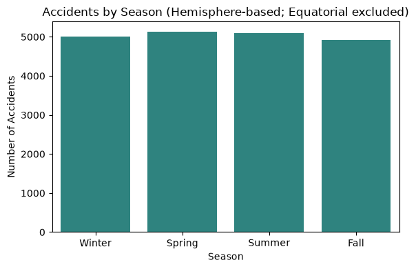
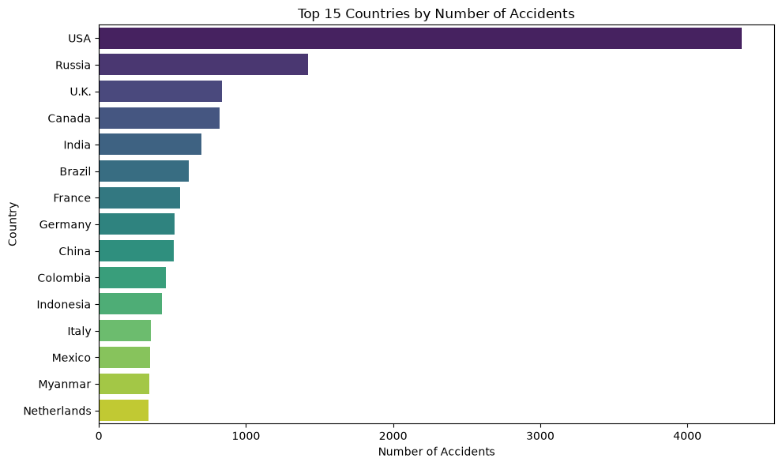
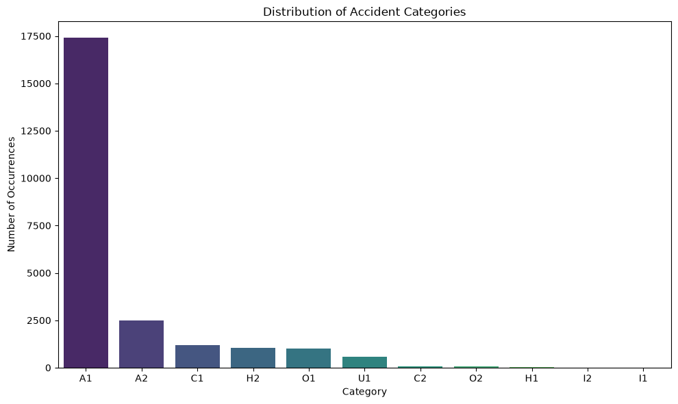

# Civil Aviation Accident Analysis

[](https://colab.research.google.com/github/theamanali/civil-aviation-accident-analysis/blob/main/analysis.ipynb)


Exploratory data analysis of **23,917 civil aviation accidents and incidents from 1919 to 2023**, from the [Aviation Safety Network](https://aviation-safety.net/) global database. The project looks at where, when, and what kind of accidents happen, and handles the messy parts of real-world data along the way: inconsistent dates, placeholder values, and fields that can't be taken at face value.

## Key Findings

- **World War II dominates the historical record.** Accidents peaked at 1,505 in 1944, and about 65% of 1943–45 records list the US Army Air Forces as operator, mostly C-47 transports. Since then, yearly counts peaked at 393 in 1969 and have averaged about 210 per year over the last decade.
- **Aviation deaths have fallen about 74% since the 1970s**, from roughly 2,200 a year to under 600 a year over the last decade. The deadliest year, 2001, is driven by ground deaths on September 11.
- **Most accidents aren't fatal.** 53% of accidents with a known fatality count killed no one, and the median fatal accident killed 5 people.
- **Modern jets are the most survivable.** About 21% of Boeing 727 and 737 accidents killed anyone, versus 62% for the DC-3. Military operators have the highest share of fatal accidents (9 of the top 10 operators, 66–82% fatal).
- **The US accounts for 18% of all recorded accidents** (4,371). The US, Russia, UK, Canada, and India together make up about 34% of the dataset, across 230 countries and regions.
- **Accident counts per country are heavily skewed.** The mean is ~100 per country but the median is 23, so a few countries account for most of the records.
- **About 73% of records are hull-loss accidents** (ASN category A1), and another 10% are accidents with repairable damage (A2). Criminal occurrences, hijackings, and other events make up most of the remainder.
- **Season makes almost no difference.** After adjusting seasons for each country's hemisphere, the four seasons are within 5% of each other (4,915–5,133 accidents).
- **No strong monthly pattern.** Per calendar day, months range from 58.4 accidents (October) to 69.1 (September). February has the lowest raw count, but that's mostly because it's the shortest month.

## Visualizations






| Accidents by month | Accidents by season (hemisphere-adjusted) |
|---|---|
|  |  |

| Top 15 countries | Accident categories |
|---|---|
|  |  |

## Approach

1. **Data loading:** pulled the dataset programmatically with `kagglehub` so the notebook runs end to end without manual downloads.
2. **Data quality audit:** built a missingness report that counts true nulls *and* placeholder values per column. Text placeholders (`"unknown"`, `"N/A"`, `"?"`, blanks) are matched case-insensitively, and numeric ones (`0`, `-1`) are skipped for columns where zero is a real value, like fatalities.
3. **Cleaning:** parsed free-form dates with `pd.to_datetime(format="mixed", errors="coerce")`, converted country placeholders (`"?"`, `"Unknown country"`) to nulls, and kept invalid rows out of time-based analysis instead of imputing them. Parsed the text `fatalities` column (`"5"` or `"5+ 1"`) into on-board, ground, and total counts with a regex, keeping missing values missing instead of treating them as 0. Grouped 3,193 aircraft type variants into 806 families (e.g. `"Douglas C-47A (DC-3)"` and `"Douglas DC-3A-197D"` → DC-3).
4. **Feature engineering:**
   - Extracted month from accident dates and normalized monthly counts by days per month.
   - Mapped each country to a hemisphere (Northern, Southern, or equatorial) so that "winter" means December in Canada but July in Australia.
   - Derived meteorological seasons from month + hemisphere, excluding countries that straddle the equator and open-ocean locations (2,450 rows) instead of guessing. The data has no coordinates, and places near the equator mostly have wet and dry seasons rather than winter and summer, so a country lookup is as precise as the season comparison needs.
5. **Aggregation and visualization:** grouped by year, month, season, country, ASN category, operator, and aircraft family with pandas, and plotted with Matplotlib and Seaborn.

## Tech Stack

Python · pandas · NumPy · Matplotlib · Seaborn · kagglehub · Google Colab

## Run It

Click **Open in Colab** above, or run it locally:

```bash
pip install -r requirements.txt
jupyter notebook analysis.ipynb
```

The dataset downloads automatically on first run.

## Next Steps

- Normalize accident counts by flight volume, so countries with more air traffic aren't overrepresented

## Data Source

[Civil Aviation Accidents](https://www.kaggle.com/datasets/warcoder/civil-aviation-accidents) on Kaggle, sourced from the Aviation Safety Network.
