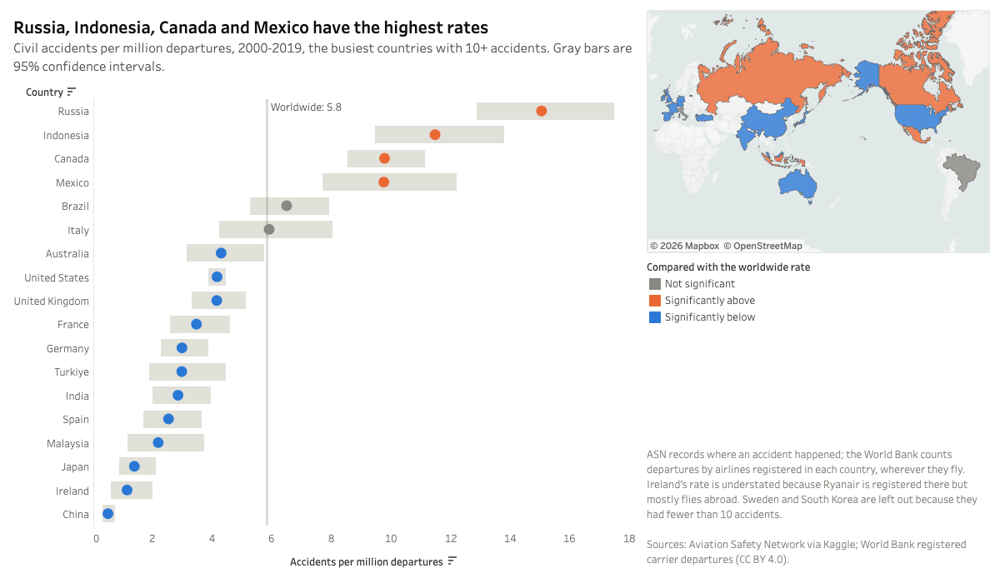
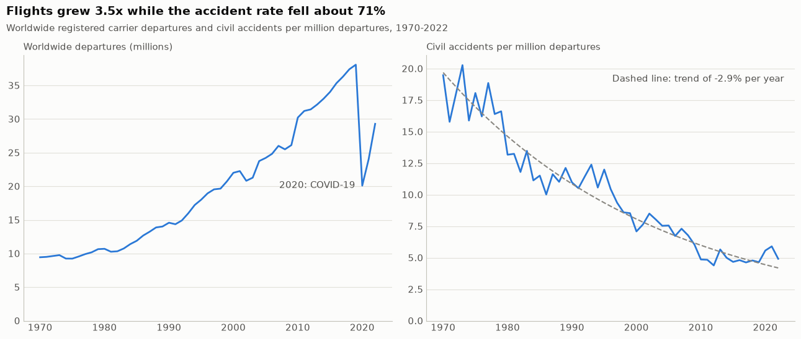
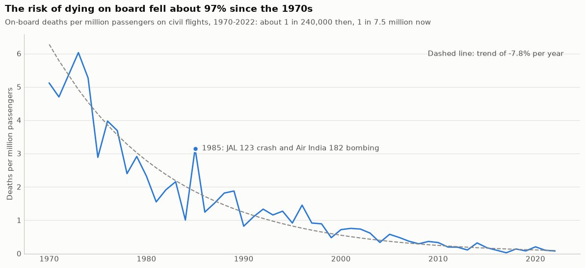
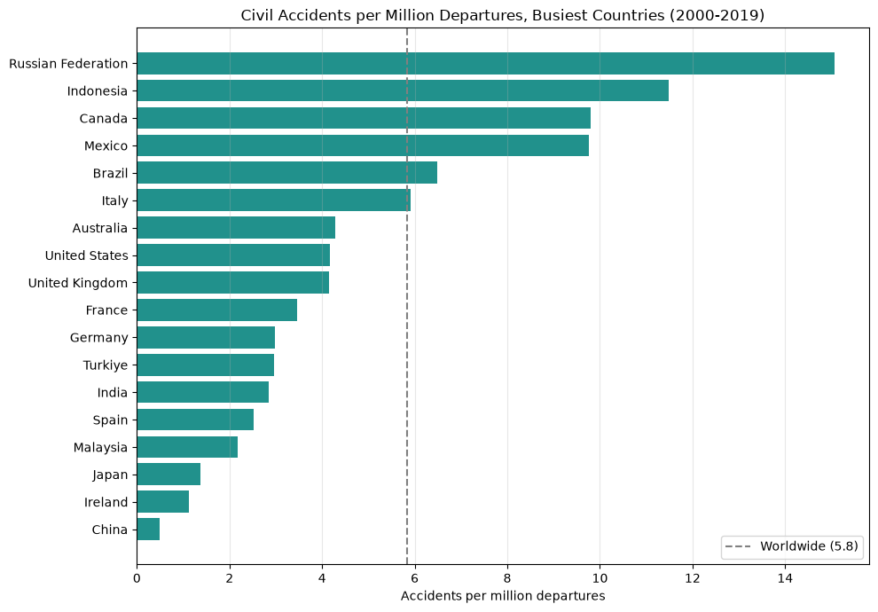
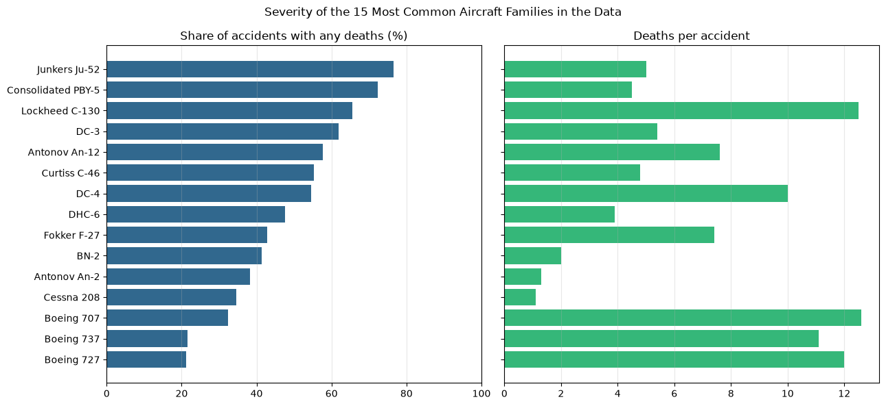

# Civil Aviation Accident Analysis

[](https://public.tableau.com/app/profile/aman.ali5463/viz/CivilAviationAccidentAnalysis/Story)
[](https://colab.research.google.com/github/theamanali/civil-aviation-accident-analysis/blob/main/analysis.ipynb)
[](https://github.com/theamanali/civil-aviation-accident-analysis/actions/workflows/run-notebook.yml)


Exploratory data analysis of **23,917 civil aviation accidents and incidents from 1919 to 2023**, from the [Aviation Safety Network](https://aviation-safety.net/) global database, combined with World Bank flight and passenger counts to measure accident and death rates.

## Key Findings

- **Flying has become far safer.** Adjusted for flight volume, the civil accident rate fell about 71%, from 17.5 accidents per million departures in the 1970s to 5.1 in 2013–2022, or about 2.9% a year (95% CI 2.7–3.1%).
- **The risk of dying on board fell about 97%.** It went from roughly 1 death per 240,000 passengers in the 1970s to 1 per 7.5 million in 2013–2022.
- **Accident rates vary widely by country.** Adjusted for flight volume (2000–2019), Russia, Indonesia, Canada, and Mexico had 2–4x the rate of the US and UK, significantly above the worldwide rate. China and Japan were among the lowest.
- **The smallest aviation markets have the highest rates.** Countries outside the 20 busiest averaged about 2.1x their rate (95% CI 1.4–3.3x), driven by the 121 countries with under 1 million departures over 2000–2019. Mid-sized countries weren't significantly different from the busiest.
- **Modern jets are the most survivable.** About 21% of Boeing 727 and 737 accidents killed anyone, versus 62% for the DC-3 (95% CIs 17–26% vs 60–64%).
- **Military accidents were more often fatal.** 66% of military operators' accidents killed someone, versus 41% for civil operators (p < 0.001). But 37% of military records lack a fatality count, so that gap may be overstated.

More findings (seasonality, World War II, fatalities, data quality) are in the [notebook](analysis.ipynb), each with a short takeaway.

## Visualizations

### Tableau

<a href="https://public.tableau.com/app/profile/aman.ali5463/viz/CivilAviationAccidentAnalysis/Story"></a>

*Point 3 of the story. Click the image to open the interactive version.*

An [interactive Tableau story](https://public.tableau.com/app/profile/aman.ali5463/viz/CivilAviationAccidentAnalysis/Story) walks through the findings in seven points:

1. Accidents per flight down 71% since the 1970s
2. The risk of dying on board down 97%
3. Accident rates for the busiest countries, on a map and with confidence intervals
4. The smallest aviation markets have the highest rates
5. Modern jets are the most survivable
6. Military accidents were more often fatal, with the missing-data caveat
7. An explore page for filtering every record by year, country, occurrence type, and civil or military operator

Hover over any point for its numbers and confidence interval. The workbook is [`tableau/civil_aviation_accident_analysis.twbx`](tableau/civil_aviation_accident_analysis.twbx), built from CSVs that `scripts/export_tableau_data.py` exports from the notebook.

### Matplotlib and Seaborn

The notebook's charts for the main findings, rendered in light and dark versions:

<picture>
  <source media="(prefers-color-scheme: dark)" srcset="images/accident_rate-dark.png">
  
</picture>

<picture>
  <source media="(prefers-color-scheme: dark)" srcset="images/deaths_per_passenger-dark.png">
  
</picture>

<picture>
  <source media="(prefers-color-scheme: dark)" srcset="images/country_accident_rates-dark.png">
  
</picture>

<picture>
  <source media="(prefers-color-scheme: dark)" srcset="images/severity_by_aircraft-dark.png">
  
</picture>

Charts for the other findings (by year, month, season, country, and category) are in the [notebook](analysis.ipynb).

## Approach

1. **Data loading:** pulled the accident dataset programmatically with `kagglehub` (pinned to one version) so the notebook runs end to end without manual downloads, and read World Bank departure and passenger counts from saved snapshots.
2. **Data quality audit:** built a missingness report that counts true nulls *and* placeholder values per column. Text placeholders (`"unknown"`, `"N/A"`, `"?"`, blanks) are matched case-insensitively, and numeric ones (`0`, `-1`) are skipped for columns where zero is a real value, like fatalities.
3. **Cleaning:** parsed free-form dates with `pd.to_datetime(format="mixed", errors="coerce")`, converted country placeholders (`"?"`, `"Unknown country"`) to nulls, and kept invalid rows out of time-based analysis instead of imputing them. Parsed the text `fatalities` column (`"5"` or `"5+ 1"`) into on-board, ground, and total counts with a regex.
4. **Feature engineering:**
   - Extracted month from accident dates.
   - Grouped 3,193 aircraft type variants into 806 families (e.g. `"Douglas C-47A (DC-3)"` and `"Douglas DC-3A-197D"` → DC-3).
   - Flagged military operators by name (air forces, navies, the USAAF, and so on) and private flights, so they can be separated from civil aviation.
   - Mapped each country to a hemisphere (Northern, Southern, or equatorial) so that "winter" means December in Canada but July in Australia, then derived meteorological seasons from month + hemisphere. Countries that straddle the equator and open-ocean locations (2,450 rows) are excluded: the data has no coordinates, and places near the equator mostly have wet and dry seasons rather than winter and summer.
5. **Aggregation:** grouped accidents and deaths by year, month, season, country, ASN category, operator, and aircraft family with pandas.
6. **Normalization:** turned counts into comparable rates:
   - Monthly counts per calendar day, since months differ in length.
   - Civil accidents per million worldwide departures (1970–2022). To keep the two sources comparable, only ASN accidents are counted, with military and private flights excluded.
   - On-board deaths per million passengers, counting bombings, shootdowns, and hijackings alongside accidents, since they kill passengers too.
   - Accident rates for the 20 busiest countries using country-level departures, with a name mapping between ASN and World Bank country names and a note that ASN records accident location while the World Bank records airline registration.
7. **Statistical testing:** chi-square tests for monthly and seasonal patterns (adjusted for month and season length), log-linear trend fits with confidence intervals for the accident and death rates, exact Poisson confidence intervals for country rates, a cluster bootstrap (resampling whole countries) for the gap between the busiest and smaller markets, Wilson confidence intervals for the share of fatal accidents, and Mann-Whitney tests comparing military with civil operators and mid-sized with the busiest countries.
8. **Visualization:** plotted with Matplotlib and Seaborn, in light and dark versions for the README, and built an interactive Tableau story from CSVs exported by the notebook.

## Tech Stack

Python · pandas · NumPy · SciPy · Matplotlib · Seaborn · Tableau · kagglehub · Google Colab

## Run It

**In your browser (nothing to install):**

1. [Open the notebook in Colab](https://colab.research.google.com/github/theamanali/civil-aviation-accident-analysis/blob/main/analysis.ipynb).
2. In Colab, choose **Runtime → Run all**.
3. If Colab warns that the notebook wasn't written by Google, click **Run anyway**.

It takes under a minute once Colab connects. Tables and charts appear under each cell. You don't need a Kaggle account.

**On your own computer** (needs [Python](https://www.python.org/downloads/) 3.12 or newer and [Git](https://git-scm.com/downloads)):

```bash
git clone https://github.com/theamanali/civil-aviation-accident-analysis.git
cd civil-aviation-accident-analysis
python3 -m venv .venv          # on Windows: python -m venv .venv
source .venv/bin/activate      # on Windows: .venv\Scripts\activate
pip install -r requirements.txt
jupyter notebook analysis.ipynb
```

In the Jupyter tab that opens in your browser, choose **Run → Run All Cells**.

**The Tableau workbook:** open [`tableau/civil_aviation_accident_analysis.twbx`](tableau/civil_aviation_accident_analysis.twbx) in [Tableau Public](https://public.tableau.com/app/learn/how-to-use-tableau-public) (free) or Tableau Desktop. Its data is packaged inside, so nothing else is needed.

## Reproducibility

- The Kaggle dataset is pinned to version 1, so results don't change if it's updated.
- World Bank data is read from saved copies in [`data/world_bank/`](data/world_bank), so results don't change when the World Bank revises past figures. To pull the latest data, run `python scripts/update_world_bank_data.py` and re-run the notebook.
- The README charts come straight from the notebook: `python scripts/export_readme_charts.py` re-renders them in light and dark versions, and GitHub shows the dark ones to visitors using dark mode.
- `python scripts/export_tableau_data.py` writes the cleaned records and the tables behind each finding (with confidence intervals and trend lines precomputed) to `tableau/` as CSVs for Tableau. To update the story after re-exporting, open the `.twbx`, choose **Data → [each data source] → Extract → Refresh**, and save it to Tableau Public again. The extracts record your machine's path to the CSVs, so on another computer Tableau asks you to locate each one; point it to the matching file in `tableau/`.
- A [GitHub Action](.github/workflows/run-notebook.yml) runs the whole notebook on pandas 2 and 3 on every push and weekly, to catch breakage from new package releases, and checks that the committed Tableau CSVs still match what the notebook produces.

## Possible Next Steps

- Accident causes and phase of flight, which this dataset doesn't record; a richer source such as the NTSB database would be needed

## Data Source

- [Civil Aviation Accidents](https://www.kaggle.com/datasets/warcoder/civil-aviation-accidents) on Kaggle, sourced from the Aviation Safety Network
- World Bank (CC BY 4.0): [Air transport, registered carrier departures worldwide](https://data.worldbank.org/indicator/IS.AIR.DPRT) and [Air transport, passengers carried](https://data.worldbank.org/indicator/IS.AIR.PSGR)

## License

Code is released under the [MIT License](LICENSE). The World Bank data in `data/world_bank/` is © World Bank, licensed under CC BY 4.0. `tableau/accidents.csv` is a cleaned copy of the [Civil Aviation Accidents](https://www.kaggle.com/datasets/warcoder/civil-aviation-accidents) dataset on Kaggle, sourced from the [Aviation Safety Network](https://aviation-safety.net/).
